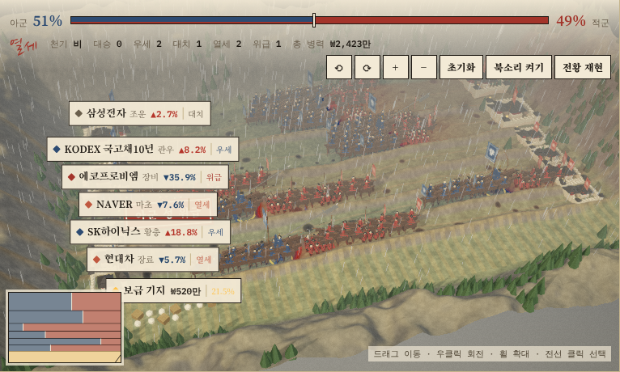
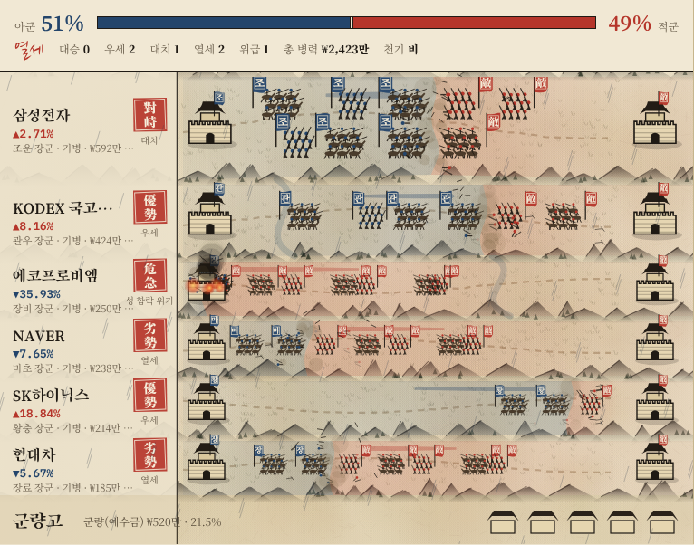
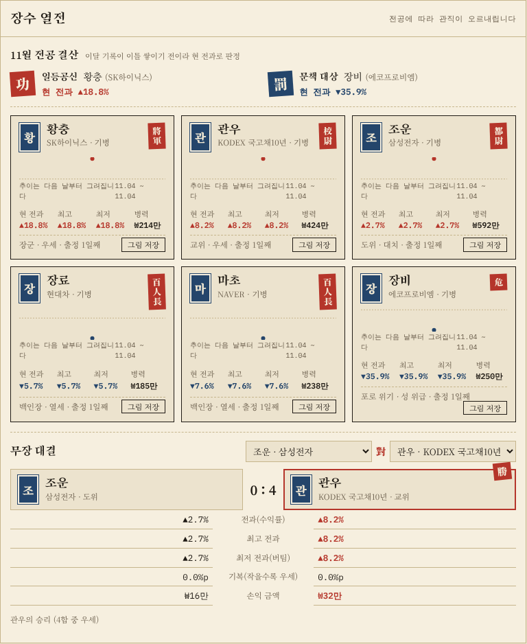

# 자금전선 작전상황실

내 주식 계좌를 삼국지풍 전장으로 보여주는 앱입니다. 종목 하나가 전장 하나이고, 수익이 나면 적성으로 진격하고 손실이 나면 아군 성이 위급해집니다.

## ⬇️ 내려받기

| 내 컴퓨터 | 내려받기 | 실행 |
|---|---|---|
| 🪟 **Windows** | [**Windows용 받기**](https://github.com/dlxkrtjs-ship-it/jageum-jeonseon/releases/latest/download/JageumJeonseon-Windows.exe) | 더블클릭 → 파란 경고창이 뜨면 「추가 정보」 → 「실행」 |
| 🍎 **Mac (M 칩·인텔 모두)** | 아래 **한 줄 설치** (권장) | 터미널에 붙여넣기 → 다음부터는 바탕화면 「자금전선 실행」 더블클릭 |
| 🐧 Linux | [Linux용 받기](https://github.com/dlxkrtjs-ship-it/jageum-jeonseon/releases/latest/download/JageumJeonseon-Linux) | `chmod +x` 후 실행 |

### 🍎 Mac은 한 줄 설치를 쓰세요
Mac은 인터넷에서 받은 서명 없는 앱을 「악성 코드가 없음을 확인할 수 없습니다」라며 막습니다. **터미널**(Spotlight에서 "터미널" 검색)을 열고 아래 한 줄을 붙여넣고 엔터를 누르세요. 내 Mac 칩에 맞는 버전을 받아 설치하고 바로 실행합니다.
```bash
curl -fsSL https://raw.githubusercontent.com/dlxkrtjs-ship-it/jageum-jeonseon/main/install.sh | bash
```
설치 후에는 바탕화면의 **「자금전선 실행」**을 더블클릭하면 됩니다. 브라우저로 zip을 받았다면: 경고창에서 「완료」 → 시스템 설정 → 개인정보 보호 및 보안 → 아래쪽 「그래도 열기」.

Mac 칩 확인(직접 zip을 받을 때만 필요): 사과(🍎) 메뉴 → 「이 Mac에 관하여」 → "Apple M…"이면 M 칩, "Intel"이면 인텔. 전체 버전 목록은 [Releases](https://github.com/dlxkrtjs-ship-it/jageum-jeonseon/releases)에 있습니다.



| 수묵 전장도 | 장수 열전 |
|---|---|
|  |  |

*(화면은 데모 모드의 가상 잔고입니다)*

- **입체 전장 / 수묵 전장도:** 성, 창병·기병·궁병 진형, 장수, 날씨(전체 형세), 함락 연출
- **판정:** 종목별 전세(대승~위급), 목표 비중 대비 배치 판정, 손절가·목표가 경보
- **군사 회의:** 전장 상황(손절선 돌파·위급·열세·대치·우세·대승·과잉 배치·군량 등)에 맞춰 제갈량·사마의·조조·관우·순욱·가후 같은 인물이 내렸을 법한 결단과 일화, 그리고 지금 할 수 있는 구체적인 행동(몇 주, 얼마, 손절가 예시)을 보여줌. 대사는 일화를 바탕으로 새로 쓴 게임 속 조언
- **장수 열전:** 관직(전과에 따라 오르내림), 전공 추이, 월간 결산, 무장 대결
- **군 재편성:** 목표 비중대로 다시 나누려면 몇 주를 사고팔아야 하는지 계산하고, 군령장(매도 → 매수 순서)으로 정리
- **출정 일지:** 진격·후퇴·승진·함락이 자동으로 기록됨
- **연병(모의전):** 가상 자금으로 24개월 투자 전쟁

> 이 앱은 **잔고 조회만** 합니다. 주문 기능은 없습니다. 판정과 계산은 단순한 규칙이며 투자 조언이 아닙니다.

## 어떻게 동작하나요

```
[내 PC]  실행 파일(로컬 서버, 127.0.0.1)  ──API 키──▶  증권사 Open API
              │  잔고(종목·수량·평단·현재가·예수금)
              ▼
         브라우저 화면 (게임)
```

- 실행 파일을 켜면 내 컴퓨터 안에서만 접속되는 작은 서버가 뜨고 브라우저가 자동으로 열립니다.
- 증권사 API 키는 **내 PC의 설정 파일**(`홈 폴더/.jageum-jeonseon/config.json`, 본인만 읽기 가능)에만 저장됩니다. 증권사 서버 말고 어디에도 보내지 않습니다.
- 실행할 때마다 새 접속 토큰을 만들어서, 실행기가 띄운 주소로 연 화면만 API를 쓸 수 있습니다. 다른 웹사이트가 내 PC의 실행기를 몰래 호출하는 것을 막습니다.
- 출정 기록(일지·전공 추이 등)도 같은 폴더의 `state.json`에 저장됩니다.
- 3D 엔진(three.js)은 앱에 포함되어 있어 외부에서 코드를 받아 오지 않습니다. 화면에는 보안 정책(CSP)이 걸려 있어 페이지가 내 PC의 실행기 말고 다른 곳으로 데이터를 보낼 수 없습니다. 외부 접속은 글꼴(Google Fonts), 실행할 때 한 번 하는 새 버전 확인(GitHub), 「내 공인 IP 확인」을 눌렀을 때의 ipify.org뿐입니다.
- 「이 증권사 키 삭제」로 저장한 키와 토큰을 지울 수 있습니다.
- 토큰이 만료되거나 다른 곳에서 새로 발급돼 폐기되면 자동으로 다시 발급받고, 호출 한도 초과(429)나 일시 장애(5xx)는 잠시 뒤 다시 시도합니다.
- 「함락·위급 알림」을 켜면 자동 동기화 중 적성 함락이나 아군 성 위급이 생겼을 때 탭이 뒤에 있어도 데스크톱 알림을 보냅니다.
- 자동 동기화는 기본으로 「장 시간에만」(한국 시간 평일 08:00~20:00, 넥스트레이드 포함) 돌아서 장이 닫힌 동안 증권사 API를 부르지 않습니다. 공휴일은 따로 거르지 않습니다.
- 실행 파일을 두 번 켜도 서버가 하나만 뜹니다. 이미 켜져 있으면 그 화면을 열고 끝납니다. 끌 때는 창을 닫거나 계좌 연결 패널의 「실행기 끄기」를 누르세요.
- 「출정 기록 내보내기 / 불러오기」로 일지·전공 추이·장수 설정을 JSON 파일로 백업하고 다른 PC로 옮길 수 있습니다(불러오기는 같은 파일을 두 번 골라야 적용).

## 지원 증권사

| 증권사 | 필요한 것 | 비고 |
|---|---|---|
| 키움증권 | REST API App Key, Secret Key | 실전/모의투자 키가 따로 있음 |
| 토스증권 | Open API Client ID, Client Secret | **허용 IP 등록 필수**. 미국 주식은 환율로 원화 환산 |
| 한국투자증권 | KIS App Key, App Secret, 계좌번호 | 모의투자 계좌 지원 |
| 여러 증권사 합치기 | 위 증권사 중 키를 저장한 곳 | 같은 종목은 수량 합산, 평균단가는 수량 가중 평균. 한 곳이 실패해도 나머지는 반영 |
| 데모 | 없음 | 가상 잔고로 체험 |

허용 IP를 등록해야 하는데 내 IP를 모르겠다면, 계좌 연결 패널의 **「내 공인 IP 확인」**을 누르세요(누를 때만 ipify.org에 한 번 접속합니다).

### 키 발급 방법

**키움증권**
1. [키움 REST API 포털](https://openapi.kiwoom.com)에 로그인
2. API 사용 신청 → App Key와 Secret Key 발급 (실전/모의 각각)
3. 포털에서 접속 IP 등록을 요구하면 이 PC의 공인 IP를 등록

**토스증권**
1. 토스증권 PC 웹(WTS) → 설정 → Open API
2. Client ID와 Client Secret 발급
3. 허용 IP에 이 PC의 공인 IP 등록 (등록하지 않으면 403 오류)
4. 계좌가 하나면 그대로 두면 됩니다. 여러 개면 키를 저장한 뒤 「계좌 목록 불러오기」를 눌러 고르세요(계좌번호는 끝 4자리만 표시)

**한국투자증권**
1. [KIS Developers](https://apiportal.koreainvestment.com)에서 App Key/App Secret 발급
2. 계좌번호는 `12345678-01` 형식

## 설치와 실행

### 실행 파일 (권장)
1. 맨 위 **⬇️ 내려받기** 표에서 내 컴퓨터용 파일을 받습니다.
2. **Windows:** 받은 `.exe`를 더블클릭합니다. "Windows의 PC 보호" 경고가 뜨면 「추가 정보」 → 「실행」.
   **Mac:** 받은 zip을 더블클릭해 풀고, 폴더 안의 **「실행하기」**를 더블클릭합니다. "확인되지 않은 개발자" 경고가 뜨면 「실행하기」를 오른쪽 클릭 → 「열기」. 그래도 막히면 시스템 설정 → 개인정보 보호 및 보안 → 「그래도 열기」.
3. 검은 창(터미널)이 뜨고 브라우저가 자동으로 열립니다. **쓰는 동안 이 창은 닫지 마세요.** 브라우저가 안 열리면 창에 찍힌 `http://127.0.0.1:8787/?t=…` 주소를 붙여넣으세요.
4. 화면 위쪽의 **🔑 계좌 연결** 패널(또는 제목 옆 「🔑 계좌 연결」 버튼)에서 증권사와 키를 넣고 **저장하고 연결 시험** → **지금 동기화**. 「자동」에서 1·5·15분마다 자동 동기화를 켤 수 있습니다.

경고가 뜨는 이유: 코드 서명(유료 인증서)이 없는 실행 파일이기 때문입니다. 소스 코드는 이 저장소에 모두 공개되어 있고, 실행 파일은 GitHub Actions가 이 소스로 직접 빌드합니다.

### 파이썬으로 직접 실행
파이썬 3.9 이상이면 추가 설치 없이 됩니다.
```bash
python3 server/warroom.py
```
옵션: `--port 8787`, `--no-browser`, `--no-update-check`(새 버전 확인 끄기), `--print-balance kiwoom`(서버 없이 잔고 JSON만 출력)

### 웹 체험판
저장소 Settings → Pages → Source를 **GitHub Actions**로 바꾸면 `app/`이 체험판으로 배포됩니다. 체험판은 계좌 연결 없이 예시 데이터·붙여넣기·모의전만 됩니다. 계좌 연결은 실행 파일에서만 됩니다(브라우저만으로는 API 키를 안전하게 숨길 수 없기 때문).

## 개발

```bash
python3 tests/test_brokers.py   # 가짜 증권사 서버로 키움·토스 응답 변환 시험
python3 tests/test_server.py    # 접속 토큰·호스트 검사, 비밀키 비노출, 파일 권한, 저장 시험
python3 tests/test_instance.py  # 중복 실행 방지, 실행기 끄기
npm i --no-save playwright@1.48.2 && npx playwright install chromium
node tests/ui_smoke.mjs         # 실행기를 띄워 브라우저로 화면·동기화·3D·모의전 오류 없는지 확인
```
빌드할 때는 이 시험들을 모두 통과해야 하고, 각 OS 실행 파일을 실제로 켜서(`--self-test`) 확인한 뒤 배포합니다.
- `server/warroom.py` — 로컬 서버와 증권사 연동 (표준 라이브러리만 사용)
- `app/index.html` — 게임 화면 (단일 파일)
- `app/vendor/` — three.js r128 (MIT, `THREE-LICENSE.txt`)
- `.github/workflows/release.yml` — `main`에 올리면 시험 → Windows/macOS(애플 실리콘·인텔)/Linux 실행 파일 빌드 → Releases에 `server/warroom.py`의 `VERSION`으로 배포
- `.github/workflows/pages.yml` — `app/`을 GitHub Pages 체험판으로 배포

새 버전 배포: `server/warroom.py`의 `VERSION`을 올리고 `main`에 푸시하면 됩니다. 실행 중인 앱은 다음 실행 때 새 버전 알림을 띄웁니다.

## 주의

- API 키는 계좌 조회 권한이 있는 비밀번호와 같습니다. 남에게 보여주거나 저장소에 올리지 마세요.
- 증권사 API 이용약관과 호출 한도를 지켜 주세요. 자동 동기화는 최소 1분 간격입니다.
- 이 앱이 보여주는 판정·계산은 투자 조언이 아니며, 실제 투자 판단과 주문은 본인 책임입니다.
